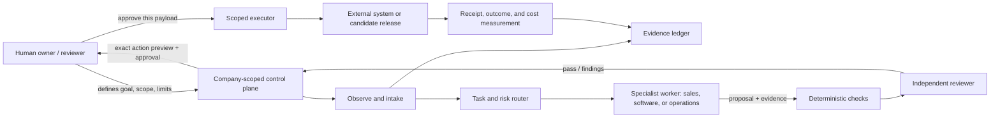

# SparkTech enterprise workforce: architecture and delivery plan

**Prepared:** 2026-10-05
**Status:** proposed plan; pilot and spending decisions remain open
**Scope:** reusable SparkTech systems that can serve separate companies without sharing their identities, data, credentials, or authority.

## Recommendation

Extend the existing Recursive Self-Enterprise Improvement (RSEI) and knowledge ledger into a company-scoped control plane. Keep the first service narrow: observe, produce an evidence-backed proposal, run it through deterministic checks and an independent verifier, then request a human decision before any external or production side effect.

Keep the first adopter choice between **LEED and Ballot Watch**. The registry currently marks both as not connected and disabled. UTern is an independent company and stays reference-only. Nothing in this plan connects to or changes UTern. The user's intended phrase after “build SparkTech for” was cut off, so this plan does not infer a project or market beyond those two candidates.

The nearest missing proof is an AI-authored repair that completes the existing reproduce → patch → test → verify loop. The Claude adapter is implemented, but no live Claude repair has run. A separate synthetic connectivity probe returned HTTP 200 for `gemini-3.8-flash` without customer data; it did not generate or verify a production repair. The local deterministic fixture cycle is the demonstrated end-to-end proof. The next architecture decision should therefore be gated on a measured, synthetic-only repair evaluation, followed by an owner-approved pilot scope.

## Current state and concrete gaps

| Area | Present evidence | Missing before an enterprise workforce |
|---|---|---|
| Software QA loop | Local browser reproduction, isolated candidate workspace, allowlist/source-drift checks, tests, browser verification, evidence manifest, local release pointer and rollback are implemented for a deliberately broken fixture. | A live AI-generated patch has not completed this loop. The fixture is not a customer service or a representative company workload. |
| Model worker | Claude Messages API adapter is tool-free, sends a bounded repair packet, validates whole-file replacements, and is covered by mock-server subprocess tests. A synthetic Gemini connectivity probe is separately recorded. | No live repair quality, token/cost, task-success, or customer-workflow measurement. Local command/time limits are not provider dollar caps. |
| Knowledge | SQLite evidence ledger stores source-backed records, reviews, execution approvals and outcomes. A bridge is connected to one canonical fixture. | No connected company source ingestion, real tenant authentication, or broad workflow integration. Tenant IDs in local records do not isolate OS or provider access. |
| Company boundaries | Example config is per-company; adopter registry grants no execution rights. LEED and Ballot Watch are disabled; UTern is independent/reference-only. | Application configuration alone is not a security boundary. No dedicated company sandbox, secret broker, egress policy or tested cross-company denial. |
| Outreach and sales | The intended roles and approval concepts are documented. | No CRM, prospect research, campaign drafting, reply triage, send adapter or consent/suppression integration is active. No messages may be sent by this plan. |
| Platform operations | Local runner records commands, evidence and recovery state. | No production monitor, incident intake, deployment adapter, infrastructure action, scheduler or production rollback integration. |
| Human review | Local release and knowledge actions have explicit review points. | No durable approval inbox or signed, expiring, payload-specific authorization for email, CRM, code merge, deployment, spend or data export. |
| Business outcomes | Metric contracts and validation code exist; a value measurement plan is documented. | No source-backed company baseline, accepted-output series, labor comparison, model bill, realized savings or net-revenue result. |
| Company operations | Role names such as Observer, Diagnostician, Builder, Verifier, Release Operator and Outcome Analyst are represented in `agents.json`. | These are provisional registry entries, not independent deployed workers, staffed job assignments or permissions. |

### Portfolio inventory and separation

The adopter registry is a partial execution-status list, not a complete inventory of every SparkTech project. Before choosing an adopter, maintain a portfolio index with one row per company or project: relationship/ownership, accountable human owner, source repository or system, operating status, data classification, permitted reuse and current RSEI status. Mark fixtures, independent companies and inactive projects distinctly. Keep every project visible in the portfolio view while tasks, credentials, raw evidence and execution rights stay scoped to the owning company. General techniques may be proposed for reuse only after the source owner approves a de-identified lesson. Do not make UTern the system's default customer context.

## Target architecture

Use four separable layers. Company identity, policy, data access and approvals stay in the execution/control layer; model output is always an untrusted proposal until validated.

### Core contracts

Every task and result should carry a company ID, source references and hashes, business owner, task goal, allowed read/write set, risk class, budget ceiling, expiry, candidate/action digest, verification result, human decision and eventual receipt. Reuse the repository's evidence manifests and run states, then generalize their versioned schemas before adding more workflows.

Keep these contracts distinct:

1. **Knowledge permission:** whether a source or lesson may be read, retained or shared.
2. **Task permission:** which files, records, endpoints and commands a worker may inspect or propose against.
3. **Action approval:** authorization for one exact, reviewable side effect, with a digest, expiry and idempotency key.
4. **Outcome evidence:** what changed and what independently verified afterward.

An approval should not become a reusable broad grant. Enforce it in application code and the execution boundary, not in the model prompt. Model-produced tool arguments or a “handoff” between agents never authorize an action by themselves.

## Workforce roles and operating loops

These are role contracts, not people or independent autonomous identities. One worker can cover multiple roles in a pilot, but the verifier must receive the testable task and evidence independently and must not inherit the builder's approval authority.

| Role | Work | Authority in initial rollout |
|---|---|---|
| Observer / intake | Read approved records, metrics and application state; report a specific finding with evidence. | Read-only, company-scoped. |
| Diagnostician / planner | Identify likely causes, business value, uncertainty and proposed bounded steps. | Proposal only. |
| Specialist worker | Draft outreach, propose code changes, or prepare an operations change. | Writes only to draft/candidate workspace. No sending, merging, deployment or live mutation. |
| Logic validator | Run deterministic invariants, policy checks, schema checks and regression tests. | May block a candidate; cannot approve it. |
| Independent verifier | Reproduce the requested result from acceptance criteria, evidence and candidate; challenge missing cases. | Read-only evaluation and findings; no side effects. |
| Human process owner | Confirms business purpose, correctness, data rights, fit, user impact and acceptance. | Approves only actions inside their own company role. |
| Human technical operator | Reviews the exact diff or command and carries out approved merge, deployment, infrastructure or rollback. | Explicit per-action approval; existing owner remains accountable. |
| Finance / outcome owner | Reconciles revenue, direct costs, labor and benefit attribution to company records. | Attests measurement definitions and sources; no model-generated financial truth. |
| Outcome analyst / librarian | Compares baseline with verified post-change results; records reusable lessons. | May propose a lesson; company owner controls cross-company reuse. |

**Software loop:** observe a reproducible defect → create isolated candidate → model proposes patch → run the exact test suite plus independent regression/security checks → verify in browser or service-level environment → show diff and evidence → owner accepts/merges → release operator separately approves deployment → monitor and roll back on failed health checks. Initial production state stays unchanged until the relevant owner explicitly approves it.

**Sales/outreach loop:** gather only approved prospect facts → draft a message with source links and a permitted purpose → run factual, personalization, consent and suppression checks → human reviews recipient and exact copy → human sends or separately approves a narrowly scoped send → log delivery/reply/opt-out and reconcile downstream status. Start with draft-only work. Do not automate sending, scraping restricted sources, or altering CRM records until the company owner approves the scope and connector permissions.

**Platform-operations loop:** read approved telemetry and runbooks → classify incident versus infrastructure failure → propose diagnostics and a bounded command/change → deterministic safety checks → separate reviewer checks blast radius and recovery → operator approves the exact action → executor applies it with a time limit, idempotency key and rollback plan → independent health check and receipt. Keep the first pilot read-only; no model-initiated production command, secret rotation, schema migration, access change or deploy.

**Logic-validation loop:** formalize the expected outcome and forbidden outcomes before task execution → run deterministic assertions where possible → verify source provenance, totals, invariants and edge cases → use a second reviewer/model only for judgment that cannot be stated as a deterministic rule → human adjudicates unresolved disagreement. LLM agreement is not proof; financial and safety-critical checks remain deterministic or owner-reconciled.

## Approval gates and separation of duties

| Gate | Required decision | Enforced boundary |
|---|---|---|
| G0 — Company setup | Named owner, legal entity, purpose, data classification, source inventory, retention, allowed providers and budget. | No worker runs without an enabled company-specific config and reviewed sandbox. |
| G1 — Task intake | Is this task in scope, are sources permitted, and is the requested outcome testable? | Read only the approved sources; reject ambiguous company identity or unsupported action. |
| G2 — Candidate review | Does the proposal meet acceptance criteria and pass deterministic/independent verification? | Candidate-only writes, diff/hash, full evidence, no execution rights. |
| G3 — External action | Does the owner approve the exact recipient/content or exact infrastructure/change payload? | One payload hash, short expiry, actor identity, scope, budget, idempotency and receipt. Any edit voids approval. |
| G4 — Release | Does the designated company operator approve merge/deploy and rollback conditions? | Distinct from worker and verifier; company-local permission and monitoring. |
| G5 — Outcome and learning | Did the expected business or quality measure change, and may the lesson be reused elsewhere? | Reconcile to source records; default lesson visibility is company-private. Cross-company reuse requires an owner-approved, de-identified reusable rule. |

For pilot milestones, an explicit human can approve through the existing task workflow and have approval recorded in the run evidence. Before a persistent or multi-user service, implement authenticated approver identity, append-only decision records, replay protection, expiry and tested denial across company boundaries. Current local approvals are workflow controls, not enterprise identity or tamper-proof audit.

## Model and tool choices to evaluate

Do not pick a model by benchmark headline alone. Evaluate the same redacted synthetic task set for patch correctness, test pass rate, reviewer disagreement, latency, tokens, dollars per accepted task, and behavior under refusal, timeout, malformed response and quota errors. Include failures and human rework in the cost denominator.

| Task tier | First evaluation candidates (2026-10-05) | Use |
|---|---|---|
| Routine diagnosis, bounded code repair | OpenAI `gpt-6.1-sol`; Anthropic `claude-sonnet-5-5` | Compare against the existing Claude adapter on fixture tasks. OpenAI describes Sol as cost-balanced for complex work; Anthropic describes Sonnet as its speed/intelligence balance. Equal published base token prices do not establish equal task economics. |
| Difficult reasoning / disputed review | OpenAI `gpt-6-astra`; Anthropic `claude-opus-5-5` | Escalation candidates only when lower-cost first pass fails a defined threshold. Re-evaluate the challenger independently; do not make builder and reviewer a single shared answer. |
| High-volume deterministic-adjacent classification | OpenAI `gpt-6-luna`; Anthropic `claude-haiku-4-5` | Use only after a labeled, company-approved test set shows adequate precision and human review rate. Keep arithmetic, permission decisions and final action gates in code. |

Published standard text-token rates on 2026-10-05 were $2 input / $10 output per million for GPT-6.1 Sol, $10 / $50 for GPT-6 Astra, and $0.10 / $0.50 for GPT-6 Luna. Anthropic listed Sonnet 5.5 at $2 / $10, Opus 5.5 at $4 / $20, and Haiku 4.5 at $1 / $5. Cached input, long-context and other tool charges can change the actual total; compare measured cost per accepted task and recheck provider prices before a funded run. Rates and model descriptions are from the [OpenAI model catalog](https://developers.openai.com/api/docs/models) and [Anthropic model overview](https://docs.anthropic.com/en/docs/about-claude/models/overview), not a SparkTech benchmark.

Keep the existing Python state machine and tool-free adapter as the baseline for the first synthetic pilot. Add a narrow provider interface around it rather than adopting a new multi-agent framework before the selected workload proves a need. Use the existing Anthropic Messages adapter and evaluate a minimal OpenAI Responses API adapter only when a model comparison is approved; in the first experiment both receive no execution tools. If an orchestration SDK is later adopted, keep scopes, approvals, logging, egress, retries and spend ceilings in SparkTech-controlled application code. OpenAI's current model guidance distinguishes GPT-6.1 Sol for intelligence/cost balance and GPT-6 Luna for high-volume tasks; Anthropic's model overview lists Sonnet 5.5 and Opus 5.5 as current models with different cost/speed positions. Recheck model availability, prices, lifecycle and company data-handling terms immediately before any funded run. The current OpenAI Agents SDK documentation also notes that function-tool input guardrails do not apply to agent handoffs and that receiving agents may get prior conversation history; do not use handoffs as a permission boundary or forward unfiltered company context.

For software changes, retain the isolated candidate workspace, allowlisted files, deterministic tests and browser evidence. For first tool connectivity, use replayable local fixtures and read-only adapters. Introduce external connectors only after the selected company owner confirms access, minimal scopes and retention. There is no active CRM, sales, production operations or scheduler integration in this checkout.

## Staged implementation and evidence gates

### Stage 0 — Confirm ownership and select a pilot

Build a short evidence packet for LEED and Ballot Watch: actual repository, accountable owner, one frequent and bounded workflow, data classification, source-of-truth systems, expected user consequence, current manual process, available baseline and acceptance criteria. Score candidate workflows on repeatable volume, observable before/after outcome, reversible local change, clean test environment, modest data sensitivity and clear approver. Select only after both the company owner and SparkTech confirm the scope. UTern is excluded as a pilot.

**Exit evidence:** selected project/repository and owner; task-specific baseline source; explicit allowed actions and forbidden actions; written success/stop criteria; no production access required for the first proof.

### Stage 1 — Prove one model-assisted task without company data

Use the existing intentionally broken fixture and a small fixed task set. Compare deterministic repair, Claude Sonnet 5.5 and GPT-6.1 Sol only if the appropriate company/provider budget and credential are approved. Keep the tool-free worker, provider spend limit, output caps and timeout; store only task ID, prompt/model/version, token/cost receipt, diff hash and test evidence. No Codex CLI attempt that can read the general repository. No provider fallback without an explicit per-run budget and recorded approval.

**Exit evidence:** reproducible AI-produced candidate, passing independent tests and browser verification, cost per accepted task, failed-case set, exact prompt/data scope and demonstrated secret/company isolation. Connectivity probes do not count as task completion.

### Stage 2 — Make the company boundary real

Create a versioned generic task/result/evidence/approval schema; add a dedicated ephemeral container or VM/OS identity per company, read-only source mount, candidate-only write mount, constrained egress, secret broker, output/artifact quota, retention cleanup and provider metering. Test explicit cross-company path, credential, ledger query, connector and network denials. The current per-company JSON config and local tenant ID are not enough for outside/untrusted workloads.

**Exit evidence:** denial tests pass; each company can access only its inventory, run store, credentials and budget; interrupt/retry does not duplicate side effects; an operator can export and delete a company's retained data.

### Stage 3 — Run a read-only chosen-company pilot

Connect one approved source using a read-only, least-privilege account. Replay a representative workload or observe a live workflow without sending, merging, deploying or mutating source data. Compare to the agreed human baseline and keep an owner review for every proposal. Add workflow-specific acceptance tests only after the owner has named current systems and policies.

**Exit evidence:** source quality and permission audit; useful-output and first-pass acceptance rates; false positives/omissions; human review and correction time; model/tool spending; no unauthorized effects; owner confirms the workflow improves a named task.

### Stage 4 — Enable one approved reversible action

Only after Stage 3 passes, select a single side effect that is easy to inspect and reverse. Prefer, in order: save a draft, create a branch or ticket, then submit a company-reviewed change. Keep external outreach in draft mode until recipient-level human approval and suppression/consent checks are implemented. Keep production operations manual until an operations owner approves a dedicated runbook and independent rollback proof.

**Exit evidence:** action receipt tied to approval digest, expiry and idempotency key; exact scope; test against stale/replayed approvals; rollback and escalation result; audited owner sign-off.

### Stage 5 — Expand the workforce by workflow, not by agent count

Add sales, developer and platform-operation adapters one at a time. Use one company-specific contract/config and acceptance suite for each. Add schedules only when a particular workflow has an owner, stable input freshness, a safe no-op outcome and notification policy. Track change in owner hours and business outcome per accepted task. Keep unselected companies disabled and their data/credentials separate.

**Scale gate:** demonstrate repeatable benefit after direct model, software, human review, contractor, payment and operating costs; quality/consent/security guards hold; the owner agrees to the next scope. If the work only moves effort into review or rework, do not claim efficiency.

## Measurement and decision rules

Agree on metric definitions and a comparable manual baseline before the pilot; do not set numeric targets until the owner supplies expected workload, economics, risk tolerance and measurement source.

- **Net revenue:** recognized gross revenue minus discounts/credits and refunds/chargebacks, from the company’s accounting definition. Keep tax collected for remittance outside revenue according to that accounting source.
- **Contribution after direct costs:** net revenue minus attributable AI/software, delivery labor, contractors/fulfillment, payment/partner/outreach and other direct costs.
- **Operating contribution:** contribution after direct costs minus owner-defined allocated operating costs.
- **Verified hours saved:** baseline labor hours minus assisted labor hours for the same task definition and comparable volume/quality. Negative values are retained. Saved hours are capacity, not cash savings, unless avoided payroll or other cash costs are evidenced.
- **First-pass acceptance:** outputs accepted without correction divided by outputs submitted for review. Track rework separately.
- **Cost per accepted output:** direct model/tool/workflow expense plus measured human review/rework cost divided by owner-accepted outputs.
- **Quality guard:** task-specific correctness, escaped defects, factual/source-grounding errors, consent/complaint outcomes and rollback rate. Efficiency is reported only alongside quality and risk.

Use the accompanying blank revenue/operations workbook for owner-entered monthly evidence. All inputs are empty, formulas stay blank until the row's required fields are supplied, each row carries a currency code, and the workbook does not connect to accounting, CRM, UTern or a production system. Reconcile filled periods with source records before reporting results.

## Decisions still required

1. Which LEED or Ballot Watch repository/workflow and owner should be evaluated first?
2. What was the intended ending of “build SparkTech for,” and what outcome matters most for that target?
3. Who may approve data access, model spend, outreach copy, code merge and production operations for each company?
4. Which source records define current revenue, direct delivery cost, operating allocation and baseline work time? Which currency is authoritative for each company?
5. Is a small paid synthetic model comparison authorized, and if so, what hard provider budget applies?
6. What data may be sent to each model provider, what can be retained, and for how long?

These are approval/data decisions; implementation can continue through synthetic local fixtures without answering them.

## References and repository evidence

Repository evidence: `systems/recursive-improvement/README.md`, `AI-WORKER-STATUS.md`, `COMPLETION.md`, `agents.json`, `companies/adopters.json`, `pilot/VALUE-MEASUREMENT.md`, `systems/knowledge/README.md`, `INTEGRATION.md` and `RESEARCH.md`.

- OpenAI model catalog and current selection guidance: https://developers.openai.com/api/docs/models
- Anthropic model catalog, IDs, current prices and selection guidance: https://docs.anthropic.com/en/docs/about-claude/models/overview
- OpenAI Agents SDK handoffs and warning that tool input guardrails do not apply to handoffs: https://openai.github.io/openai-agents-python/handoffs/
- Anthropic agent evaluation guidance: https://www.anthropic.com/engineering/demystifying-evals-for-ai-agents
